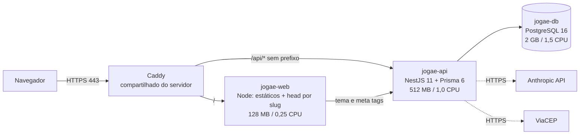

# 2. Arquitetura e requisitos não funcionais

Detalhes de modelo de dados e funcionalidades: [DOCUMENTACAO.md](../DOCUMENTACAO.md). Aqui ficam as decisões e as metas de qualidade.

## 2.1 Visão de contêineres

[verificado: `compose.yaml`, `infra/caddy/sites/jogae.caddy`] O banco só existe na rede interna do Compose. A única porta do host é `127.0.0.1:8101` (web, acesso por túnel SSH); a exposição pública passa só pelo Caddy.

## 2.2 Decisões de arquitetura (ADRs resumidos)

| ID | Decisão | Motivo | Consequência / quando rever |
|---|---|---|---|
| D1 | SaaS multiusuário (um dono = uma arena), não marketplace | Concorrentes marketplace parecem abandonados; SaaS tem tração | Sem multi-filial; rever com demanda real |
| D2 | Monólito modular NestJS + SPA React | Equipe pequena; simplicidade de deploy | Módulos por domínio (`courts`, `reservations`, `customers`...) permitem extrair serviços depois |
| D3 | JWT próprio (`@nestjs/jwt`) sem Passport; guards `JwtAuthGuard` + `RolesGuard` | Controle e menos dependências | Tokens no `localStorage`: risco XSS; considerar cookie httpOnly |
| D4 | OTP por telefone para jogador, sem senha | Fricção mínima | Hoje sem provedor de SMS (ver riscos R1) |
| D5 | Um Postgres por app, versão fixa | Isolamento, backup e upgrade independentes | Série maior exige aviso e backup testado |
| D6 | Tema por lojinha derivado no servidor (OKLCH, AA) | Identidade do dono sem quebrar contraste | Fixtures em `scripts/gen-theme-fixtures.mjs` |
| D7 | Servidor Node no front só reescreve `<head>` por slug | Substitui o middleware de borda do Vercel; sem SSR completo | SEO limitado ao head |
| D8 | **Código e produção na mesma pasta; build local** (2026-10-10) | Sem clientes ainda; agilidade | Reavaliar ao ter clientes (fase D) |
| D9 | `DESIGN.md` + `tokens.css` são a única fonte de cor | Consistência; `lint` falha com hex fora dos tokens | Valor novo exige justificativa no commit |
| D10 | Fotos hoje em base64 no banco | Simplicidade inicial | Mover para objeto (R2) antes de escalar |

Decisões novas devem virar um arquivo numerado em `docs/adr/` (modelo: contexto, alternativas, decisão, consequências). [pendente: a pasta ainda não existe; esta tabela é o registro provisório]

## 2.3 Requisitos não funcionais e como são verificados

| Atributo | Meta | Como é garantido hoje | Verificação |
|---|---|---|---|
| Disponibilidade | Sem SLA contratual; objetivo interno 99% mensal (~7 h de indisponibilidade) | `restart: unless-stopped`, healthchecks, Uptime Kuma | Painel de status do servidor |
| Desempenho | Páginas principais utilizáveis em <3 s em 4G; API p95 <300 ms em operações comuns | Compressão zstd/gzip no Caddy; limites de recurso | [pendente] medir (Lighthouse/web-perf e logs) e registrar linha de base |
| Segurança | OWASP Top 10 tratado nos pontos de entrada | `helmet`, `ValidationPipe({whitelist})`, throttling global 120 req/min/IP e limites menores em login/OTP/chat, usuário não-root nos contêineres, cabeçalhos do Caddy | Revisão de segurança antes de cada go-live |
| Privacidade (LGPD) | Dados mínimos; termos e privacidade publicados | Páginas legais; sem segredo no git | [pendente] mapa de dados pessoais e fluxo de exclusão a pedido |
| Integridade de dados | Nenhuma migração deixa o banco incompleto | `prisma migrate deploy` na subida; checagem de `_prisma_migrations` no pós-deploy | `publicar.sh` smoke |
| Recuperabilidade | RPO ≤ 24 h; RTO ≤ 2 h | Backup diário local (retenção 7 dias) + backup antes de cada publicação | Teste de restauração em `/srv/infra/backup/restore.md` |
| Acessibilidade | Contraste AA, foco visível, movimento reduzido | Regras do `DESIGN.md`; tema com contraste calculado | Revisão manual por tela [pendente: auditoria automática] |
| Manutenibilidade | Código tipado, módulos coesos, lint limpo | TypeScript, ESLint/oxlint, testes | CI e `publicar.sh` |
| Custo | ≤ R$100/mês no total | Limites de CPU/RAM; sem serviço pago novo | Revisão mensal |

## 2.4 Orçamento de recursos do Jogaê

| Contêiner | RAM | CPU |
|---|---|---|
| jogae-db | 2 GB | 1,5 |
| jogae-api | 512 MB | 1,0 |
| jogae-web | 128 MB | 0,25 |

Se um limite estourar, avisar o dono antes de aumentar.

## 2.5 Interfaces externas

| Sistema | Uso | Falha tolerada? |
|---|---|---|
| Anthropic API | Chatbot do portal | Sim: mensagem padrão, sem erro 500; teto diário por IP/global |
| ViaCEP | Preencher endereço | Sim: usuário digita manualmente |
| Provedor SMS/WhatsApp | OTP e notificações | **Não implementado** (R1) |
