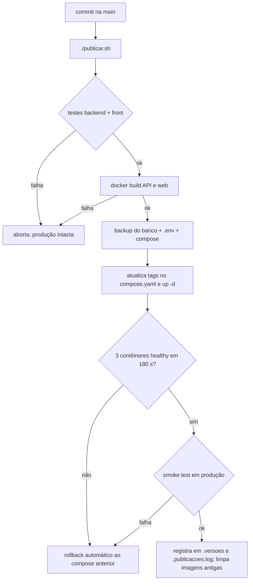

# 4. Release e deploy

## 4.1 Pipeline de entrega

Todo o pipeline é o script [`publicar.sh`](../../publicar.sh) [verificado]. Ele usa trava (`flock`) contra execução simultânea e mantém as 5 imagens mais novas para rollback.

## 4.2 Comandos

| Comando | Efeito |
|---|---|
| `./publicar.sh` | Testes, build, backup, deploy, verificação |
| `./publicar.sh --dry-run` | Mostra o que faria, sem mudar nada |
| `./publicar.sh --sem-testes` | Pula testes unitários (build e smoke continuam). Só em emergência, com registro do motivo |
| `./publicar.sh --status` | O que está no ar e o histórico |
| `./publicar.sh --rollback` | Volta à publicação anterior |

## 4.3 Gates de qualidade (portões)

| Portão | Critério | Se falhar |
|---|---|---|
| G1 testes | Jest (API) e `node --test` (front) verdes | Nada muda |
| G2 build | Imagens constroem | Nada muda |
| G3 backup | `pg_dump` e arquivos salvos | Nada muda |
| G4 saúde | `jogae-db`, `jogae-api`, `jogae-web` healthy | Rollback |
| G5 fumaça | `/api/health`=200, web `/healthz`=200, `/`=200, slug inexistente=404, embed com `frame-ancestors *`, nenhuma migração incompleta | Rollback |

## 4.4 Gestão de mudanças

| Tipo | Exemplo | Aprovação | Janela | Cuidados |
|---|---|---|---|---|
| Padrão (baixo risco) | Texto, estilo, ajuste de tela | Dono (quem desenvolve) | Qualquer hora | Pipeline normal |
| Normal | Nova funcionalidade, endpoint | Dono | Preferir baixo movimento (madrugada ou fora do horário de pico das arenas) | DoD completo |
| Com migração | Coluna/tabela nova | Dono | Idem | Migração **aditiva e compatível** com a versão anterior; backup verificado |
| Destrutiva | Remover coluna, trocar tipo | Dono, explícita | Janela combinada | Duas etapas (expandir → migrar dados → contrair), restauração testada |
| Emergência | Falha em produção, vulnerabilidade | Dono | Imediata | Corrigir à frente ou reverter; registrar o incidente (5.5) |

**Regra de migração** [verificado no script]: o rollback devolve o **código**, não o banco. Se a versão nova aplicou migrações, o script avisa e a volta exige conferir o procedimento de restauração. Por isso migrações precisam ser aditivas.

## 4.5 Registro e rastreabilidade

Cada publicação grava: data UTC, imagens nova e anterior, contagem de migrações antes/depois e a pasta do backup (`.publicacoes.log`, `.versoes`; ambos fora do git). Mudança de infraestrutura entra no `/srv/docs/CHANGELOG.md`. [pendente: gerar notas de versão do projeto, ver 4.7]

## 4.6 Checklist de go-live

Antes de abrir ao público e aceitar o primeiro cliente real:

- [ ] `OTP_EXPOSE_DEV_CODE` desligado e **provedor real** de SMS/WhatsApp integrado; geração do OTP já usa `crypto.randomInt` [verificado]
- [ ] Limite de requisições do chat revisado (hoje: 30/IP/dia, 500 global, configuráveis) e modelo do chatbot trocado
- [ ] Domínio próprio, DNS, certificado e redirecionamento da exceção `razielhub.cloud`
- [ ] `VITE_SHOW_STATS` desligado enquanto houver dado fictício; **dados de demonstração removidos** do banco
- [ ] `VITE_CONTACT_EMAIL`, `VITE_CNPJ`, `VITE_WHATSAPP` definidos (e `ARG`/`ENV` no Dockerfile do front)
- [ ] Termos de uso e privacidade revisados (LGPD)
- [ ] Backup **fora do servidor** ativo e restauração testada
- [ ] Monitor no Uptime Kuma para `/api/health` e a home, com alerta
- [ ] Revisão de segurança (autenticação, autorização por papel, upload em base64, CORS, cabeçalhos)
- [ ] Linha de base de desempenho medida (Core Web Vitals)
- [ ] Ambiente de desenvolvimento separado da produção, ou decisão registrada de manter a exceção
- [ ] Canal de suporte e responsável definidos

## 4.7 Versionamento e notas de versão

Proposta: ao fim de cada marco, criar tag SemVer (`vMAIOR.MENOR.PATCH`), com notas curtas (novidades, correções, migrações, ações manuais). `0.x` enquanto não houver cliente; `1.0.0` no go-live. Mudança incompatível da API ou do banco incrementa o número maior. [pendente: última tag `v0.2.0` não acompanha o estado atual]

## 4.8 Ambientes

| Ambiente | Uso | Dados | Estado |
|---|---|---|---|
| Local (cada pessoa) | Desenvolvimento | Seed fictício | Disponível (`docker-compose.dev.yml`) |
| Teste/homologação | Ensaiar antes da produção | Fictícios | Existe um ambiente de teste do redesign; [pendente: documentar acesso e dados aqui] |
| Produção | `jogae.razielhub.cloud` | Reais (futuros) | No ar |
